# Python Robotics Projects

Python codes and [textbook](docs/index_main.rst) for robotics algorithm.

Owned and maintained by **Mahim Trivedi**.


# Table of Contents
   * [What is this?](#what-is-python-robotics-projects)
   * [How it works](#how-it-works)
   * [Requirements](#requirements-to-run-the-code)
   * [Documentation](#documentation-textbook)
   * [How to use](#how-to-use)
   * [How testing works](#how-testing-works)
   * [Localization](#localization)
      * [Extended Kalman Filter localization](#extended-kalman-filter-localization)
      * [GPS/IMU Fusion Localization with Bias Estimation](#gpsimu-fusion-localization-with-bias-estimation)
      * [Particle filter localization](#particle-filter-localization)
      * [Histogram filter localization](#histogram-filter-localization)
      * [Monte Carlo localization with a lidar](#monte-carlo-localization-with-a-lidar)
      * [Interacting multiple model (IMM) filter](#interacting-multiple-model-imm-filter)
   * [Mapping](#mapping)
      * [Gaussian grid map](#gaussian-grid-map)
      * [Ray casting grid map](#ray-casting-grid-map)
      * [Lidar to grid map](#lidar-to-grid-map)
      * [k-means object clustering](#k-means-object-clustering)
      * [Rectangle fitting](#rectangle-fitting)
      * [Multi-object tracking](#multi-object-tracking)
   * [SLAM](#slam)
      * [Iterative Closest Point (ICP) Matching](#iterative-closest-point-icp-matching)
      * [FastSLAM 1.0](#fastslam-10)
   * [Path Planning](#path-planning)
      * [Dynamic Window Approach](#dynamic-window-approach)
      * [Grid based search](#grid-based-search)
         * [Dijkstra algorithm](#dijkstra-algorithm)
         * [A* algorithm](#a-algorithm)
         * [D* algorithm](#d-algorithm)
         * [D* Lite algorithm](#d-lite-algorithm)
         * [Potential Field algorithm](#potential-field-algorithm)
         * [Grid based coverage path planning](#grid-based-coverage-path-planning)
         * [Particle Swarm Optimization (PSO)](#particle-swarm-optimization-pso)  
      * [State Lattice Planning](#state-lattice-planning)
         * [Biased polar sampling](#biased-polar-sampling)
         * [Lane sampling](#lane-sampling)
      * [Probabilistic Road-Map (PRM) planning](#probabilistic-road-map-prm-planning)
      * [Rapidly-Exploring Random Trees (RRT)](#rapidly-exploring-random-trees-rrt)
         * [RRT*](#rrt)
         * [RRT* with reeds-shepp path](#rrt-with-reeds-shepp-path)
         * [LQR-RRT*](#lqr-rrt)
      * [Quintic polynomials planning](#quintic-polynomials-planning)
      * [Reeds Shepp planning](#reeds-shepp-planning)
      * [LQR based path planning](#lqr-based-path-planning)
      * [Optimal Trajectory in a Frenet Frame](#optimal-trajectory-in-a-frenet-frame)
      * [ORCA multi-robot collision avoidance](#orca-multi-robot-collision-avoidance)
   * [Path Tracking](#path-tracking)
      * [move to a pose control](#move-to-a-pose-control)
      * [Stanley control](#stanley-control)
      * [Rear wheel feedback control](#rear-wheel-feedback-control)
      * [Linear–quadratic regulator (LQR) speed and steering control](#linearquadratic-regulator-lqr-speed-and-steering-control)
      * [Model predictive speed and steering control](#model-predictive-speed-and-steering-control)
      * [Nonlinear Model predictive control with C-GMRES](#nonlinear-model-predictive-control-with-c-gmres)
      * [Model predictive path integral (MPPI) control](#model-predictive-path-integral-mppi-control)
      * [iLQR trajectory optimization](#ilqr-trajectory-optimization)
      * [Control barrier function safety filter](#control-barrier-function-safety-filter)
   * [Arm Navigation](#arm-navigation)
      * [N joint arm to point control](#n-joint-arm-to-point-control)
      * [Arm navigation with obstacle avoidance](#arm-navigation-with-obstacle-avoidance)
   * [Aerial Navigation](#aerial-navigation)
      * [drone 3d trajectory following](#drone-3d-trajectory-following)
      * [rocket powered landing](#rocket-powered-landing)
   * [Bipedal](#bipedal)
      * [bipedal planner with inverted pendulum](#bipedal-planner-with-inverted-pendulum)
   * [License](#license)
   * [Use-case](#use-case)
   * [Contribution](#contribution)
   * [Support](#support)
   * [Owner and maintainer](#owner-and-maintainer)

# What is Python Robotics Projects?

Python Robotics Projects is a Python code collection and a [textbook](docs/index_main.rst) of robotics algorithms.

Features:

1. Easy to read for understanding each algorithm's basic idea.

2. Widely used and practical algorithms are selected.

3. Minimum dependency.

See this documentation for more details:

- [Getting Started — Python Robotics Projects documentation](docs/modules/0_getting_started/1_what_is_python_robotics_main.rst)


# How it works

A mobile robot runs the same loop many times a second: work out where it is,
see what is around it, plan a path to the goal, and steer along that path.
Each folder holds the algorithms for one part of that loop. Every demo runs on
its own, so you can study one part at a time. The folders in the "Other robot
types" box are separate examples that plan and control their own motion.

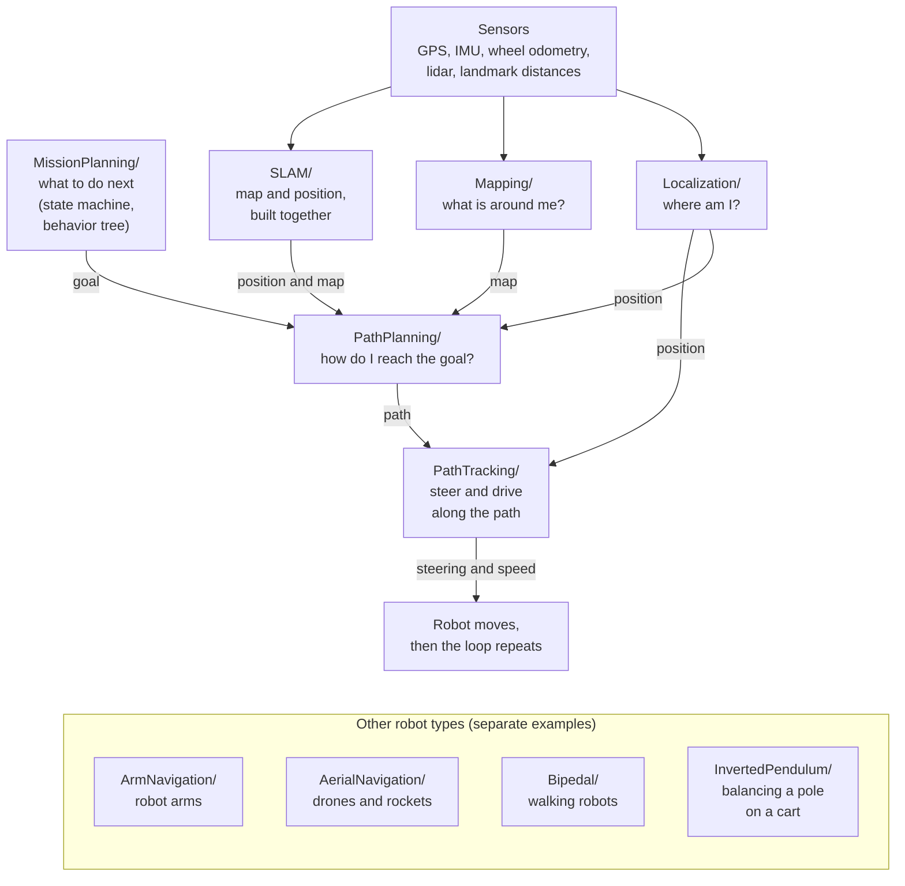


# Requirements to run the code

For running each sample code:

- [Python 3.13.x](https://www.python.org/)
 
- [NumPy](https://numpy.org/)
 
- [SciPy](https://scipy.org/)
 
- [Matplotlib](https://matplotlib.org/)
 
- [cvxpy](https://www.cvxpy.org/) 

For development:
  
- [pytest](https://pytest.org/) (for unit tests)
  
- [pytest-xdist](https://pypi.org/project/pytest-xdist/) (for parallel unit tests)
  
- [mypy](https://mypy-lang.org/) (for type check)
  
- [sphinx](https://www.sphinx-doc.org/) (for document generation)
  
- [pycodestyle](https://pypi.org/project/pycodestyle/) (for code style check)

# Documentation (Textbook)

This README only shows some examples of this project. 

If you are interested in other examples or mathematical backgrounds of each algorithm, 

You can check the full documentation (textbook) in the docs folder: [Welcome to the Python Robotics Projects documentation\! — Python Robotics Projects documentation](docs/index_main.rst)

# How to use

1. Clone or download this repo.


2. Install the required libraries.

- using conda :

  ```terminal
  conda env create -f requirements/environment.yml
  ```
 
- using pip :

  ```terminal
  pip install -r requirements/requirements.txt
  ```


3. Execute python script in each directory.

4. Add star to this repo if you like it :smiley:. 

# How testing works

Every algorithm has a test in the `tests` folder. Run them all with
`bash runtests.sh`, or `pytest tests -Werror` on Windows. The tests do more
than run each demo: they check that the answers are right.

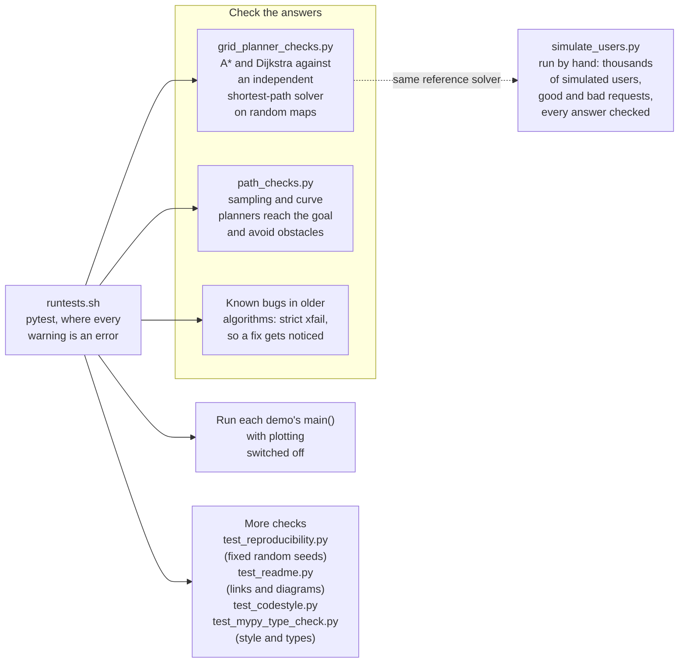

The demo GIFs in this README are made by `python utils/make_demo_gifs.py`. It
runs every demo with its animation switched on, so it also catches plotting
errors that the tests miss, because the tests switch plotting off.

# Localization

How it works: every filter repeats the same predict and update loop.

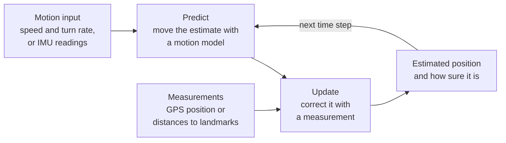

The filters differ in how they store the estimate. The Extended Kalman Filter
and GPS/IMU fusion keep one Gaussian (a mean and a covariance), the particle
filter keeps many weighted guesses and resamples them, and the histogram filter
keeps a probability for every grid cell. Monte Carlo localization is a particle
filter that scores its guesses with a whole lidar scan against a map, and the
IMM filter keeps one Gaussian per motion model, each with a probability.

## Extended Kalman Filter localization

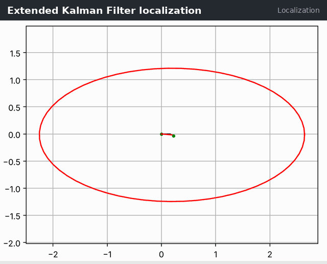

**How it works:** Every time step the filter predicts where the robot has moved from its speed and turn rate, then corrects that guess with a noisy GPS-like position fix, trusting each in proportion to how certain it is. Blue line: true path. Black line: dead reckoning (odometry only, it drifts). Red line: EKF estimate. Green dots: GPS fixes. Red ellipse: how uncertain the estimate is.

Reference

- [documentation](docs/modules/2_localization/extended_kalman_filter_localization_files/extended_kalman_filter_localization_main.rst)

## GPS/IMU Fusion Localization with Bias Estimation

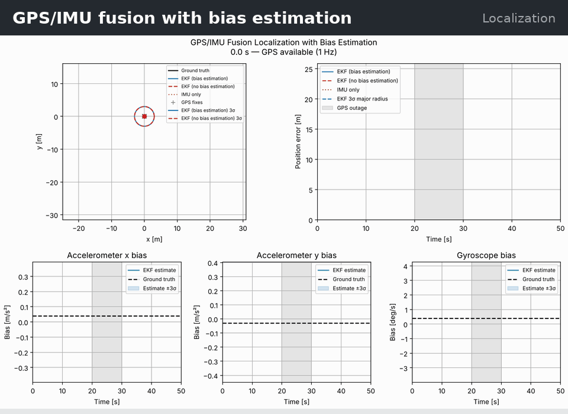

**How it works:** The accelerometer and gyroscope drive the prediction many times a second, and each GPS fix corrects both the position and the filter's estimate of the sensors' small constant errors (biases). In the grey band GPS is missing, so the filter runs on the IMU alone and its uncertainty grows until GPS returns.

An extended Kalman filter fuses body-frame accelerometer and gyroscope readings
with lower-rate GPS positions, estimates sensor biases, and continues inertial
prediction during a temporary GPS outage. The animation compares it with an
EKF without bias estimation and IMU-only dead reckoning using the same sensor
measurements. It also plots the accelerometer and gyroscope bias estimates
against their true values, with covariance-derived 3σ position ellipses and
bias uncertainty bands.

- [documentation](docs/modules/2_localization/gps_imu_fusion/gps_imu_fusion_main.rst)
- [sample code](Localization/gps_imu_fusion/gps_imu_fusion.py)

## Particle filter localization

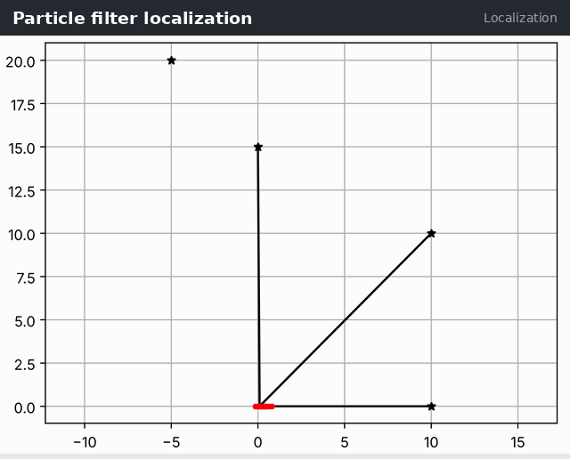

**How it works:** The filter keeps many guesses of the robot's position (particles). Each step every particle moves with the odometry plus random noise, is weighted by how well it explains the measured distances to the landmarks, and the particles are resampled when the weights get uneven, so good guesses multiply. Red dots: particles. Black stars: landmarks; black lines: the distance measurements.

This is a sensor fusion localization with Particle Filter(PF).

The blue line is true trajectory, the black line is dead reckoning trajectory,

and the red line is an estimated trajectory with PF.

It is assumed that the robot can measure a distance from landmarks (RFID).

These measurements are used for PF localization.

Reference

- [PROBABILISTIC ROBOTICS](http://www.probabilistic-robotics.org/)


## Histogram filter localization

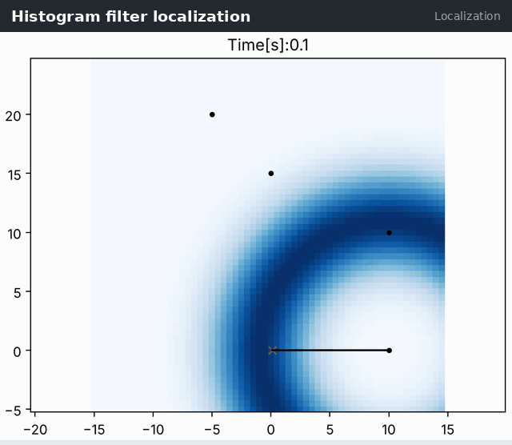

**How it works:** The map is split into grid cells, each holding the probability that the robot is there. Each step the probabilities are shifted by the measured motion and blurred by its noise, then multiplied by how well each cell matches the measured distances to the landmarks.

This is a 2D localization example with Histogram filter.

The red cross is true position, black points are RFID positions.

The blue grid shows a position probability of histogram filter.  

In this simulation, x,y are unknown, yaw is known.

The filter integrates speed input and range observations from RFID for localization.

Initial position is not needed.

Reference

- [PROBABILISTIC ROBOTICS](http://www.probabilistic-robotics.org/)

## Monte Carlo localization with a lidar

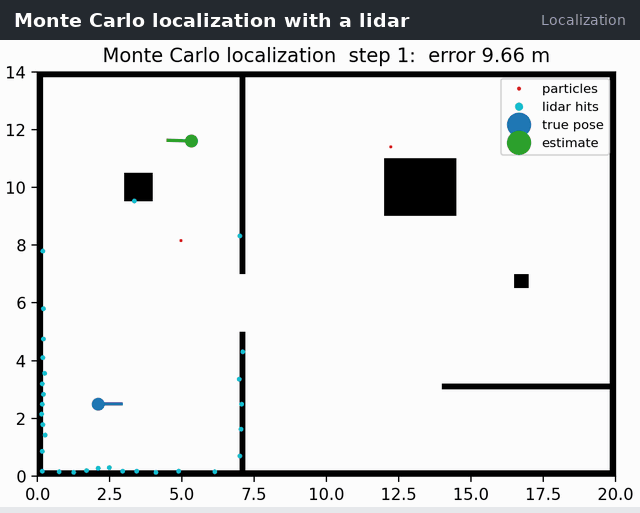

**How it works:** The robot does not know where it starts, so the particles (guesses of its pose) begin spread over the whole floor plan. Each step every particle moves with the noisy odometry and is weighted by how well the lidar scan, placed at its pose, lines up with the walls: every beam should end near a wall, and the distance to the nearest wall is read from a distance map computed once. Resampling multiplies the good guesses and the cloud collapses onto the robot. When the scans suddenly fit worse than they used to, some particles are swapped for random ones, so a cloud that settled on the wrong place can still find the right one (Augmented MCL). Red dots: particles. Cyan dots: lidar hits. Blue: the true pose. Green: the estimate.

- [sample code](Localization/monte_carlo_localization/monte_carlo_localization.py)

Reference

- [PROBABILISTIC ROBOTICS](http://www.probabilistic-robotics.org/)

- Monte Carlo Localization for Mobile Robots

## Interacting multiple model (IMM) filter

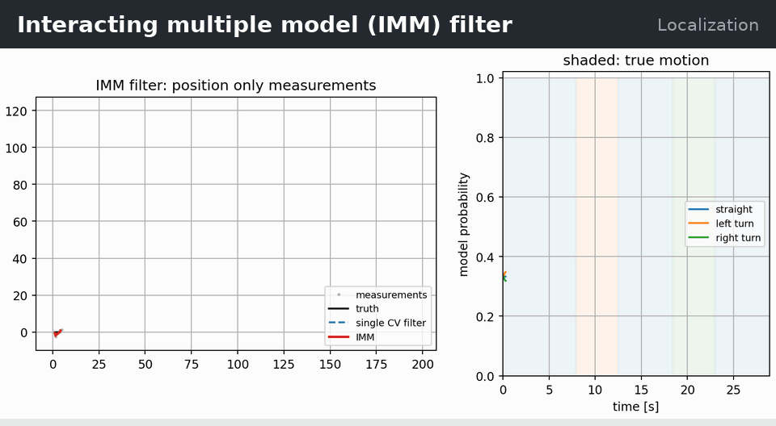

**How it works:** Only the position of a vehicle is measured while it drives straight, turns left, drives straight and turns right. No single motion model fits all of that, so three Kalman filters run side by side, one per model (straight, left turn, right turn), each with a probability. Every step the filters' estimates are mixed by how likely a switch between models is, each filter predicts with its own model and is corrected by the measurement, the models that predicted well gain probability, and the output is the probability-weighted blend. Left: the truth (black), the measurements (grey), the IMM estimate (red) and a single constant-velocity filter tuned for its lowest error (blue dashed). Right: the model probabilities; the shading shows the true motion.

- [sample code](Localization/imm_filter/imm_filter.py)

Reference

- The Interacting Multiple Model Algorithm for Systems with Markovian Switching Coefficients

# Mapping

How it works: raw sensor points become either a grid map or a list of objects,
and a tracker follows the objects from scan to scan.

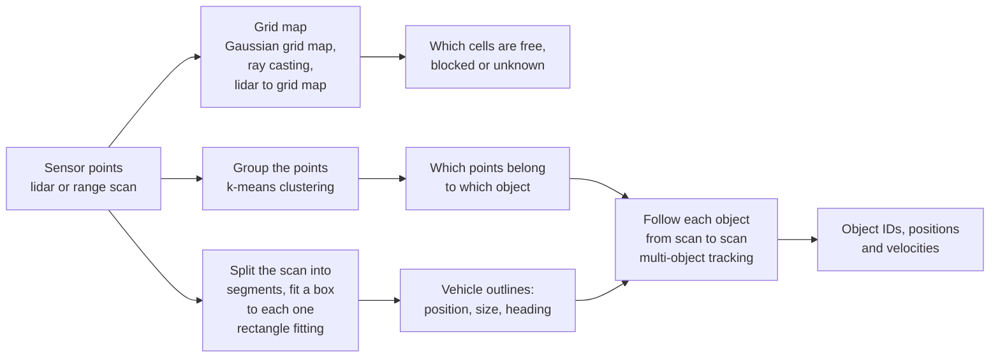

## Gaussian grid map

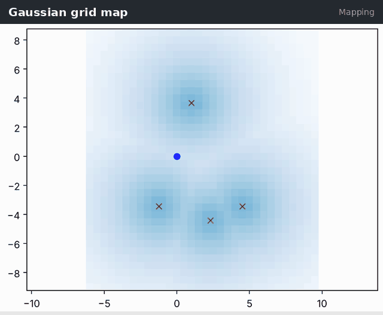

**How it works:** Each cell's chance of being blocked comes from its distance to the nearest obstacle point, passed through a Gaussian: cells close to an obstacle are dark blue and fade to white further away. Red crosses: obstacle points. Blue dot: the robot. The demo repeats with new random obstacles.

This is a 2D Gaussian grid mapping example.

## Ray casting grid map

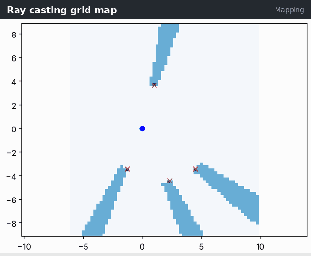

**How it works:** Rays are cast from the robot (blue dot) in small angle steps. On each ray, the first obstacle point (red cross) marks a blocked cell, and every cell behind it is hidden from the sensor, so it is shaded as unknown. White cells are free space the sensor can see.

This is a 2D ray casting grid mapping example.

## Lidar to grid map

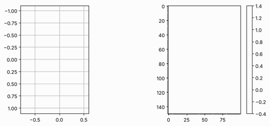

**How it works:** Each lidar beam is a line from the sensor to the point it hit. Cells along a beam are free, the cell at its end is occupied, and cells that no beam reaches stay unknown. Left: the beams (red) from the sensor (blue dot). Right: the grid map (green: free, pink: occupied, white: unknown).

This example shows how to convert a 2D range measurement to a grid map.

## k-means object clustering

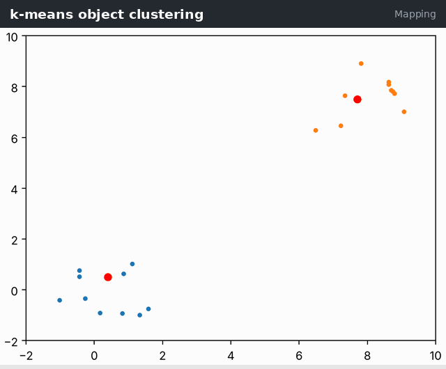

**How it works:** k-means places k cluster centres, assigns every point to its nearest centre, moves each centre to the mean of its points, and repeats until nothing changes. Here it follows two moving objects: dots are the measured points, coloured by cluster, and red circles are the centres.

This is a 2D object clustering with k-means algorithm.

## Rectangle fitting

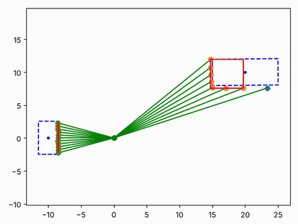

**How it works:** The scan is split into groups of nearby points; for each group the fitter tries many rotation angles and keeps the box whose sides fit the points best (an L-shape fit). Green lines: lidar beams from the sensor at the origin. Blue dashed boxes: the true vehicles. Red boxes: the fitted rectangles.

This is a 2D rectangle fitting for vehicle detection.

## Multi-object tracking

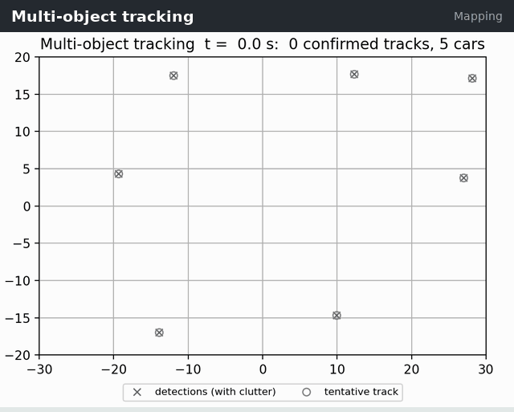

**How it works:** Five cars cross the sensor's view. Each scan misses some cars and adds a few false detections (clutter). Every track is a constant-velocity Kalman filter. Each scan the tracks are predicted forward, every track-detection pair is scored by how likely the detection is under the track's prediction (pairs that are too unlikely are ruled out), and the Hungarian algorithm pairs them so that as many as possible match at the lowest total score. Detections left over start tentative tracks (hollow circles); a track is confirmed after three hits and gets an ID, and a track that keeps being missed is deleted. Grey bands: the true paths. Crosses: detections. Coloured: confirmed tracks with their IDs.

- [sample code](Mapping/multi_object_tracking/multi_object_tracking.py)

Reference

- The Hungarian Method for the Assignment Problem

- Tracking and Data Fusion: A Handbook of Algorithms

# SLAM

Simultaneous Localization and Mapping(SLAM) examples

How it works: the robot estimates its own path and the map at the same time.

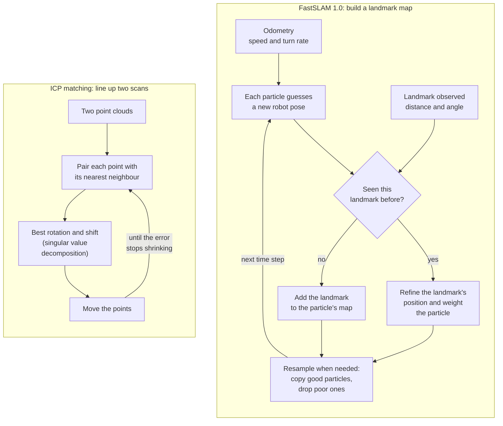

## Iterative Closest Point (ICP) Matching

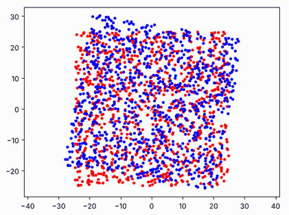

**How it works:** ICP lines up two point clouds: it pairs each point with its nearest neighbour in the other cloud, solves for the rotation and shift that best fit those pairs, moves the points, and repeats until the error stops shrinking. Red dots: the reference scan. Blue dots: the scan being moved into place, which ends up covering the red one.

This is a 2D ICP matching example with singular value decomposition.

It can calculate a rotation matrix, and a translation vector between points and points.

Reference

- Introduction to Mobile Robotics: Iterative Closest Point Algorithm


## FastSLAM 1.0

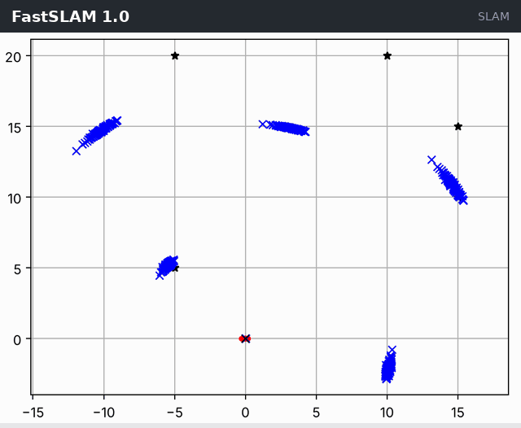

**How it works:** Each particle is one guess of the robot's path and carries its own small Kalman filter for every landmark it has seen. Particles move with the odometry, are weighted by how well their landmark map explains each new observation, and are resampled when needed.

This is a feature based SLAM example using FastSLAM 1.0.

The blue line is ground truth, the black line is dead reckoning, the red line is the estimated trajectory with FastSLAM.

The red points are particles of FastSLAM.

Black points are landmarks, blue crosses are estimated landmark positions by FastSLAM.


Reference

- [PROBABILISTIC ROBOTICS](http://www.probabilistic-robotics.org/)

- SLAM simulations


# Path Planning

How it works: every planner turns a map, a start and a goal into a path.

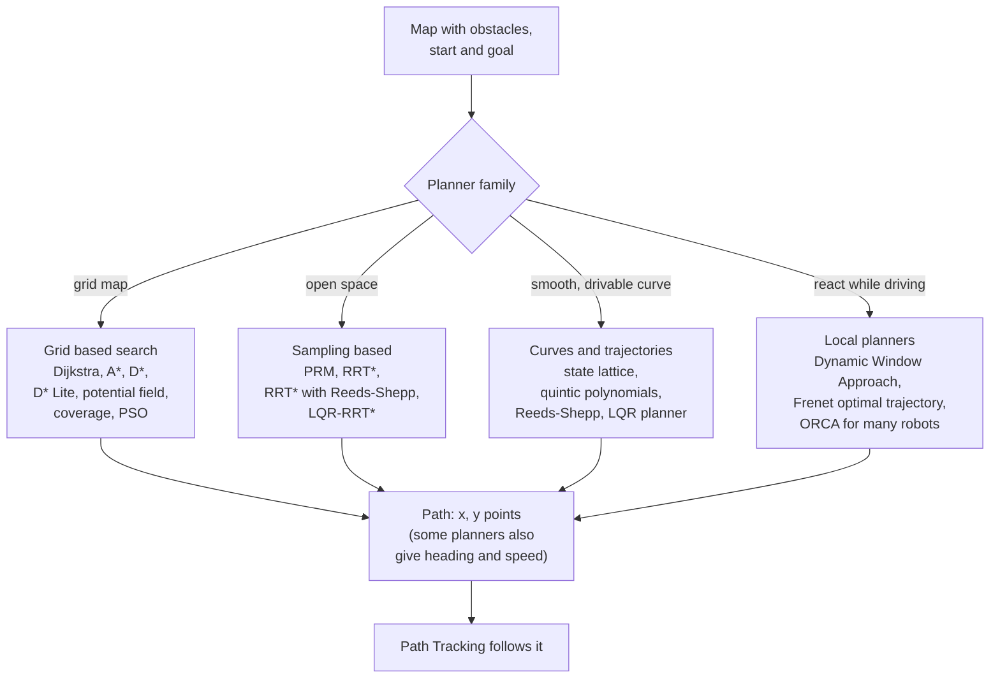

Grid based search works on a map of cells: Dijkstra and A* spread out cell by
cell from the start until they reach the goal. Sampling based planners scatter
random points and connect the ones with a clear line between them. Curve planners solve for a smooth path the vehicle can
actually drive. Local planners try many short moves every time step and keep
the best one; with ORCA, many robots each pick a safe velocity at once, every
pair sharing the effort of avoiding each other.

## Dynamic Window Approach

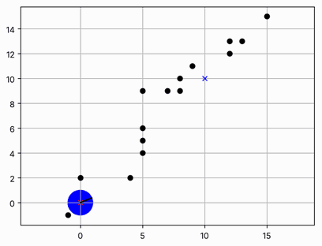

**How it works:** Every step the planner tries many speed and turn-rate pairs the robot can reach within one control cycle (the dynamic window), simulates each for a short time, and picks the one that best heads for the goal, keeps clear of obstacles and stays fast. Black dots: obstacles. Blue cross: goal. Green line: the chosen short trajectory. Red line: the path driven.

This is a 2D navigation sample code with Dynamic Window Approach.

- The Dynamic Window Approach to Collision Avoidance

## Grid based search

### Dijkstra algorithm

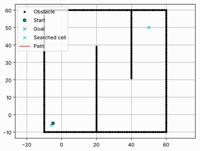

**How it works:** Dijkstra always expands the cheapest cell found so far (kept in a priority queue), so the search spreads evenly in every direction until it reaches the goal; the path is then traced back through each cell's parent. Black dots: walls. Red line: the shortest path.

This is a 2D grid based the shortest path planning with Dijkstra's algorithm.

In the animation, cyan points are searched nodes.

### A\* algorithm

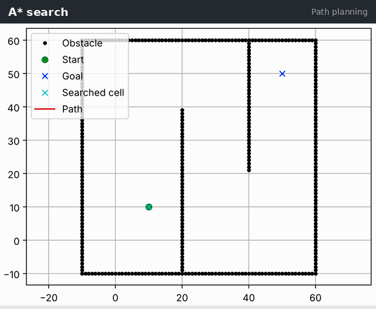

**How it works:** A* expands the cell with the lowest cost so far plus the straight-line distance still left to the goal, so the search leans toward the goal and visits far fewer cells than Dijkstra, yet still finds the shortest path. Black dots: walls. Green dot: start. Blue cross: goal. Red line: the path.

This is a 2D grid based the shortest path planning with A star algorithm.

In the animation, cyan points are searched nodes.

Its heuristic is 2D Euclid distance.

### D\* algorithm

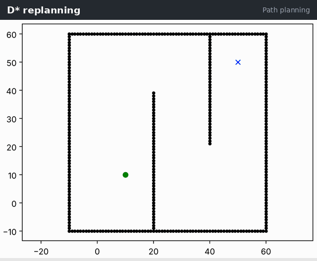

**How it works:** D* plans backwards from the goal and stores every cell's cost to reach it. When the robot finds a new obstacle on its way (green dots), only the costs it affects are repaired, and the robot carries on along a new path (red) without planning from scratch.

This is a 2D grid based the shortest path planning with D star algorithm.

The animation shows a robot finding its path avoiding an obstacle using the D* search algorithm.

Reference

- [D* Algorithm Wikipedia](https://en.wikipedia.org/wiki/D*)

### D\* Lite algorithm

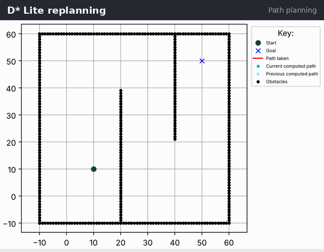

**How it works:** Like D*, D* Lite plans backwards from the goal and, when the robot discovers an obstacle, repairs only the part of the plan that the obstacle changes, so replanning while moving stays fast.

This algorithm finds the shortest path between two points while rerouting when obstacles are discovered. It has been implemented here for a 2D grid.

The animation shows a robot finding its path and rerouting to avoid obstacles as they are discovered using the D* Lite search algorithm.

Refs:

- [D* Lite](http://idm-lab.org/bib/abstracts/papers/aaai02b.pdf)
- Improved Fast Replanning for Robot Navigation in Unknown Terrain

### Potential Field algorithm

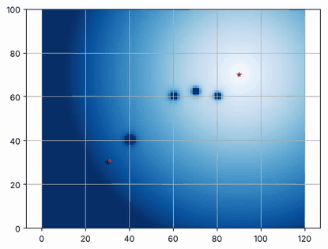

**How it works:** The goal pulls the robot and every obstacle pushes it away; adding the two gives a potential value for every cell. The robot keeps stepping to the neighbouring cell with the lowest potential, like a ball rolling downhill. Black star: start. Magenta star: goal. Red dots: the path.

This is a 2D grid based path planning with Potential Field algorithm.

In the animation, the blue heat map shows potential value on each grid.

Reference

- Robotic Motion Planning:Potential Functions

### Grid based coverage path planning

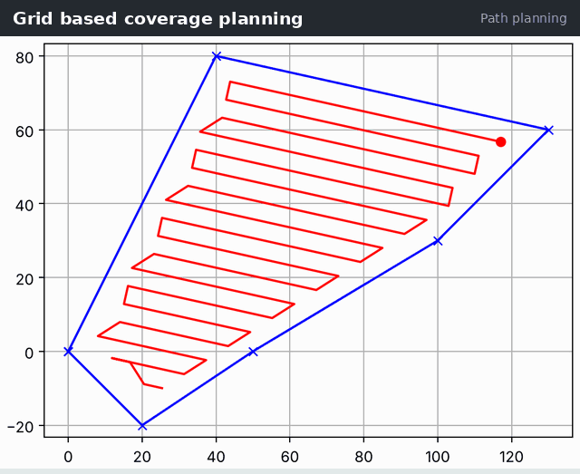

**How it works:** The area inside the polygon (blue) is turned into a grid and swept in back-and-forth lanes, like mowing a lawn, so every free cell is visited once. Red line: the sweep path. Red dot: the robot. The GIF shows three example areas.

This is a 2D grid based coverage path planning simulation.

### Particle Swarm Optimization (PSO)

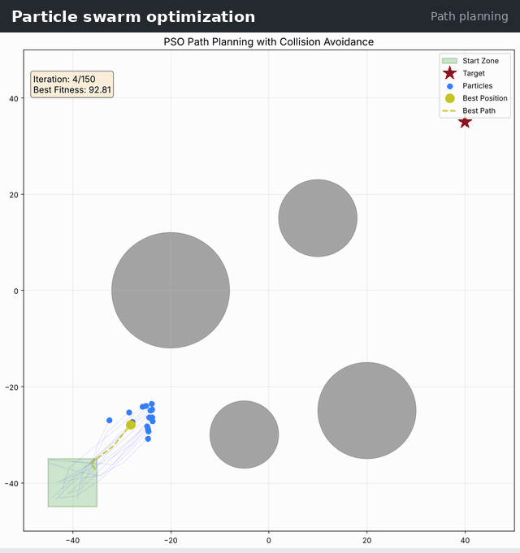

**How it works:** Each particle flies through the map. Every iteration it turns partly toward the best spot it has found itself and partly toward the best spot the whole swarm has found, where best means close to the goal without hitting an obstacle. The swarm's best positions over time join up into the path.

This is a 2D path planning simulation using the Particle Swarm Optimization algorithm.

PSO is a metaheuristic optimization algorithm inspired by bird flocking behavior. In path planning, particles explore the search space to find collision-free paths while avoiding obstacles.

The animation shows particles (blue dots) converging towards the optimal path (yellow line) from start (green area) to goal (red star).

References

- [Particle swarm optimization - Wikipedia](https://en.wikipedia.org/wiki/Particle_swarm_optimization)

- ["Particle Swarm Optimization" (1995)](https://ieeexplore.ieee.org/document/488968)


## State Lattice Planning

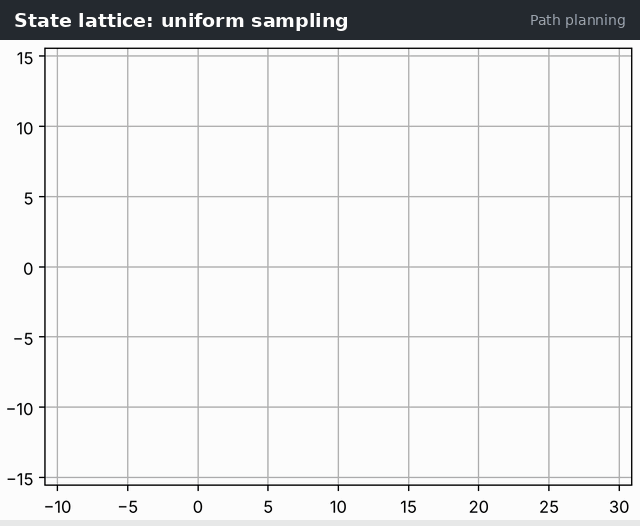

**How it works:** The planner picks target states (position and heading) spread evenly ahead of the vehicle and, for each one, solves for a smooth trajectory the vehicle can drive to reach it exactly. Together the trajectories (red) form a lattice of options to choose from.

This script is a path planning code with state lattice planning.

This code uses the model predictive trajectory generator to solve boundary problem.

Reference 

- [Optimal rough terrain trajectory generation for wheeled mobile robots](https://journals.sagepub.com/doi/pdf/10.1177/0278364906075328)

- State Space Sampling of Feasible Motions for High-Performance Mobile Robot Navigation in Complex Environments


### Biased polar sampling

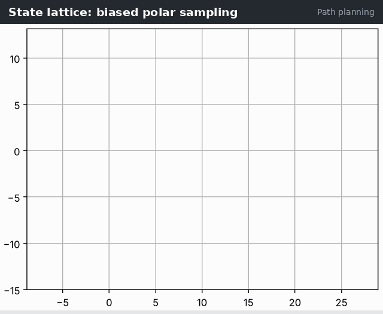

**How it works:** Same trajectory generator, but more target states are placed around the goal direction, so there are more options where they matter.

Target states are sampled on a polar grid, more densely around the goal direction.

### Lane sampling

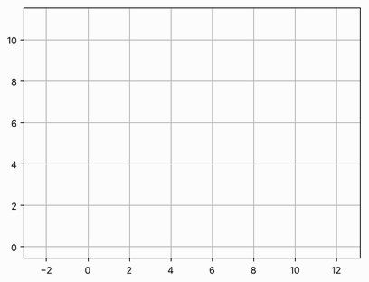

**How it works:** The target states are spread across the lane at a set distance ahead, all pointing along the lane, so the trajectories show the ways to move across to a new position in the lane.

Target states are sampled across the width of a lane ahead of the vehicle.

## Probabilistic Road-Map (PRM) planning 

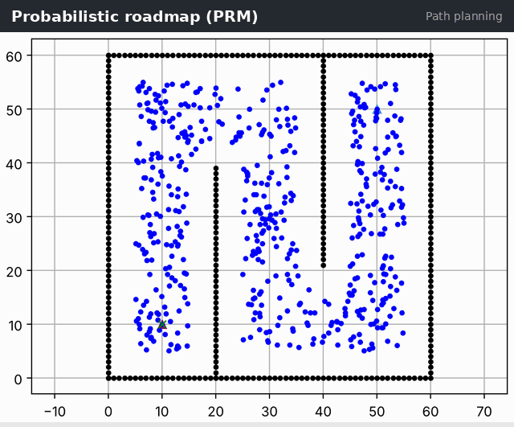

**How it works:** Random points are scattered over the free space and each is joined to its nearest neighbours when the straight line between them is clear; this graph is the roadmap. Dijkstra then searches the roadmap from the start to the goal.

This PRM planner uses Dijkstra method for graph search.

In the animation, blue points are sampled points,

Green crosses are the points searched with the Dijkstra method,

The red line is the final path of PRM.

Reference

- [Probabilistic roadmap \- Wikipedia](https://en.wikipedia.org/wiki/Probabilistic_roadmap)

　　

## Rapidly-Exploring Random Trees (RRT)

### RRT\*

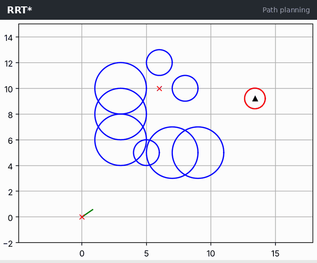

**How it works:** RRT grows a tree from the start by picking random points and extending the nearest branch toward them. RRT* also rewires: each new node picks the parent that gives it the shortest path, and nearby nodes switch to it when that shortens theirs, so the path keeps improving as the tree grows.

This is a path planning code with RRT\*

Blue circles are obstacles, green lines are the search tree, red crosses are the start and goal, and the red dashed line is the final path.

Reference

- [Incremental Sampling-based Algorithms for Optimal Motion Planning](https://arxiv.org/abs/1005.0416)

- [Sampling-based Algorithms for Optimal Motion Planning](https://citeseerx.ist.psu.edu/document?repid=rep1&type=pdf&doi=bddbc99f97173430aa49a0ada53ab5bade5902fa)

### RRT\* with reeds-shepp path

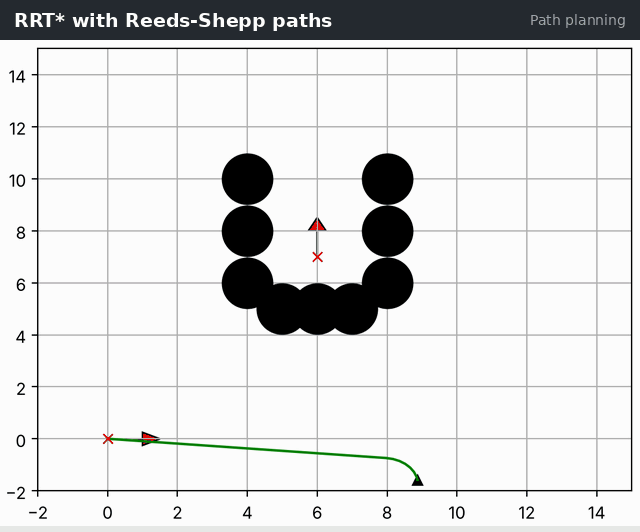

**How it works:** The same RRT* search, but each node is a car pose (position and heading) and each branch is a Reeds-Shepp curve, which a car can drive forwards and backwards with a limited turning radius. Black circles: obstacles. Green: the tree. Red: the final path.

Path planning for a car robot with RRT\* and reeds shepp path planner.

### LQR-RRT\*

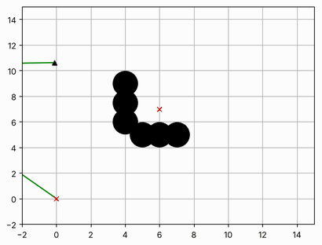

**How it works:** RRT* again, but every branch is made by an LQR controller steering a double-integrator model toward the new point, so the branches follow the system's dynamics. Black circles: obstacles. Green: the tree. Red: the final path.

This is a path planning simulation with LQR-RRT\*.

A double integrator motion model is used for LQR local planner.

Reference

- LQR\-RRT\*: Optimal Sampling\-Based Motion Planning with Automatically Derived Extension Heuristics

- LQR\-RRTstar: LQR\-RRT\* method is used for random motion planning of a simple pendulum in its phase plot


## Quintic polynomials planning

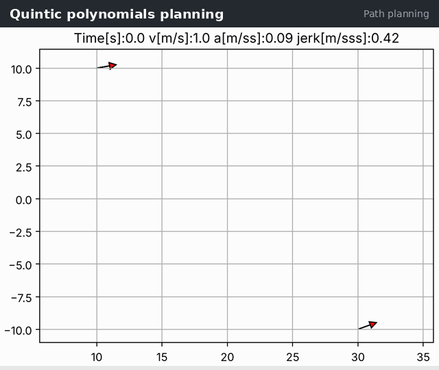

**How it works:** x(t) and y(t) are each a fifth-order polynomial whose six coefficients come from the start and goal position, speed and acceleration. The planner tries longer and longer travel times and keeps the first one whose acceleration and jerk stay within limits; the arrow then drives along the red path.

Motion planning with quintic polynomials.

It can calculate a 2D path, velocity, and acceleration profile based on quintic polynomials.

Reference

- [Local Path Planning And Motion Control For Agv In Positioning](https://ieeexplore.ieee.org/document/637936/)

## Reeds Shepp planning

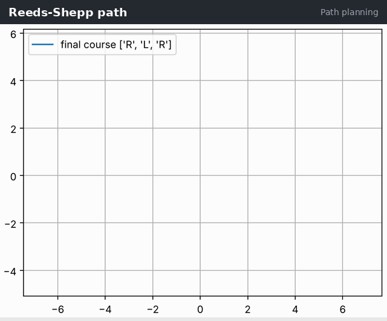

**How it works:** A car that can drive forwards and backwards with a minimum turning radius goes from the start pose to the goal pose (arrows). Every Reeds-Shepp path is a short sequence of left turns (L), right turns (R) and straight pieces (S); the planner checks all the patterns and keeps the shortest. The legend shows the pattern it chose.

A sample code with Reeds Shepp path planning.

Reference

- 15.3.2 Reeds\-Shepp Curves

- [optimal paths for a car that goes both forwards and backwards](https://pdfs.semanticscholar.org/932e/c495b1d0018fd59dee12a0bf74434fac7af4.pdf)

- pyReedsShepp: Implementation of Reeds Shepp curve\.


## LQR based path planning

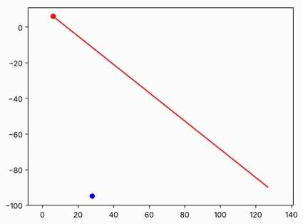

**How it works:** The path is found by simulating an LQR controller that drives a double-integrator model (position and velocity in x and y) from the start (red dot) to a goal (blue dot); the red line is the result. The demo plans to ten random goals.

A sample code using LQR based path planning for double integrator model.

## Optimal Trajectory in a Frenet Frame 

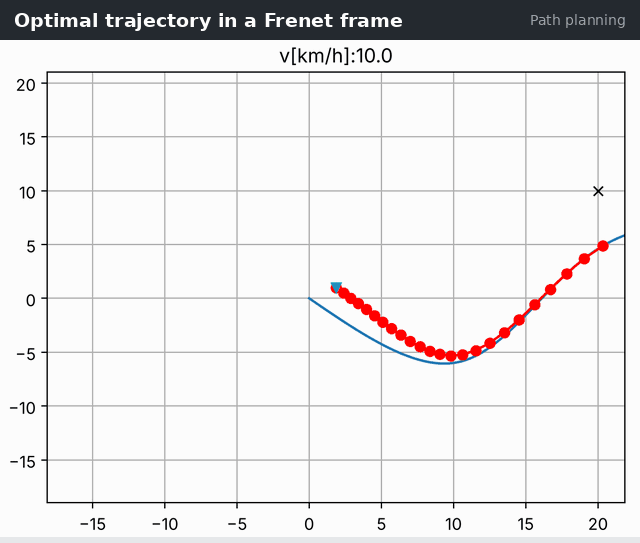

**How it works:** Positions are measured along the road and across it. Every step the planner samples many sideways and speed profiles (polynomials), turns each into a trajectory, drops those that hit an obstacle or break the speed, acceleration or curvature limits, and drives the cheapest one left.

This is optimal trajectory generation in a Frenet Frame.

The blue line is the target course and black crosses are obstacles.

The red line is the chosen trajectory, and the cyan triangle is the vehicle.

Reference

- Optimal Trajectory Generation for Dynamic Street Scenarios in a Frenet Frame

- [Optimal trajectory generation for dynamic street scenarios in a Frenet Frame](https://www.youtube.com/watch?v=Cj6tAQe7UCY)

## ORCA multi-robot collision avoidance

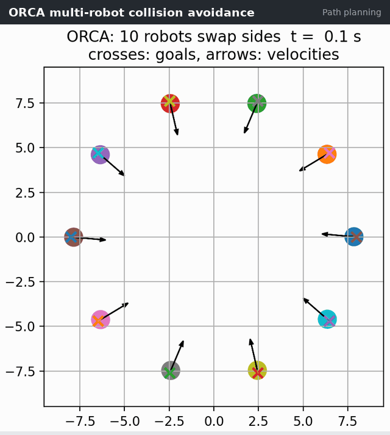

**How it works:** Ten robots on a circle must each reach the point opposite, so they all meet in the middle. Every step each robot chooses its velocity on its own: for each neighbour it works out which velocities would collide within 3 s, and keeps the half of all velocities that avoids that, with each robot of a pair doing half of the avoiding. A small linear program then picks, inside all these half-planes and the speed limit, the velocity closest to the one heading straight for the goal. Robots in perfect symmetry would stall in a ring, so every robot keeps slightly to the right and the crowd flows through like a roundabout. Crosses: the goals. Arrows: the velocities.

- [sample code](PathPlanning/ORCA/orca.py)

Reference

- Reciprocal n-Body Collision Avoidance


# Path Tracking

How it works: a feedback loop keeps the vehicle on the path.

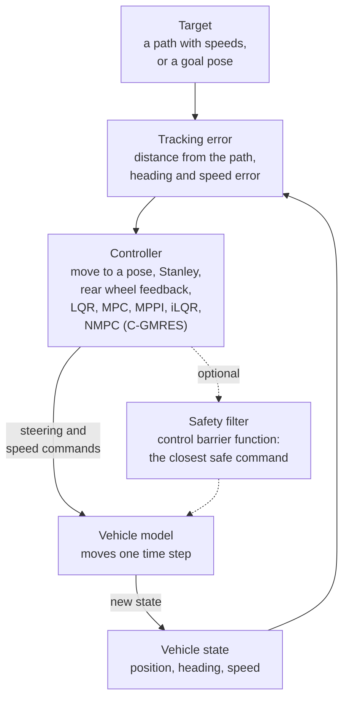

## move to a pose control

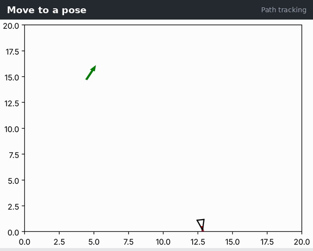

**How it works:** The controller looks at the distance to the goal and two angles (toward the goal, and the goal's own heading) and sets the speed and turn rate from them, so the robot arrives pointing the right way. Red arrow: start. Green arrow: goal. Black triangle: the robot. Blue dashed line: its path. The demo runs five random start and goal poses.

This is a simulation of moving to a pose control

Reference

- ["Robotics, Vision and Control" \| SpringerLink p102](https://link.springer.com/book/10.1007/978-3-642-20144-8)


## Stanley control

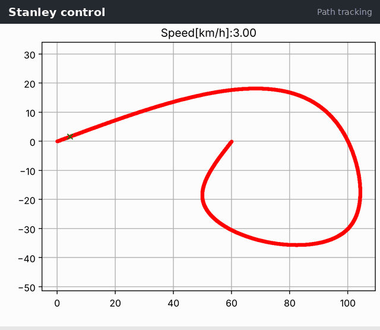

**How it works:** Stanley steers using two errors measured at the front axle: the heading error to the path, and the sideways distance from it, which becomes an extra steering angle that shrinks as the speed rises. A PID loop holds the target speed. Red dots: the course. Blue line: the car's path. Cross: the target point on the course.

Path tracking simulation with Stanley steering control and PID speed control.

Reference

- Stanley: The robot that won the DARPA grand challenge

- [Automatic Steering Methods for Autonomous Automobile Path Tracking](https://www.ri.cmu.edu/pub_files/2009/2/Automatic_Steering_Methods_for_Autonomous_Automobile_Path_Tracking.pdf)


## Rear wheel feedback control

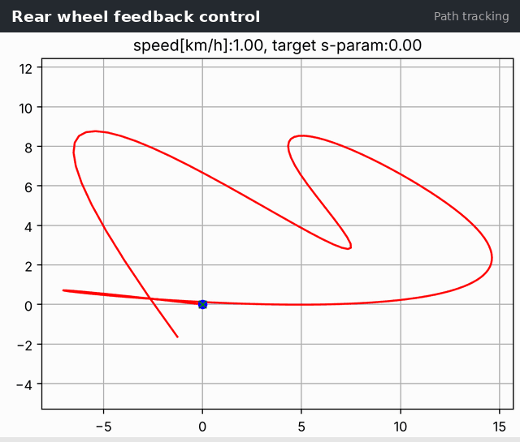

**How it works:** The steering command comes from the position and heading errors measured at the rear axle plus the path's curvature, through a feedback law that drives both errors to zero; a PID loop holds the speed. Red line: the course. Blue dots: the car's path. Green cross: the target point.

Path tracking simulation with rear wheel feedback steering control and PID speed control.

Reference

- [A Survey of Motion Planning and Control Techniques for Self-driving Urban Vehicles](https://arxiv.org/abs/1604.07446)


## Linear–quadratic regulator (LQR) speed and steering control

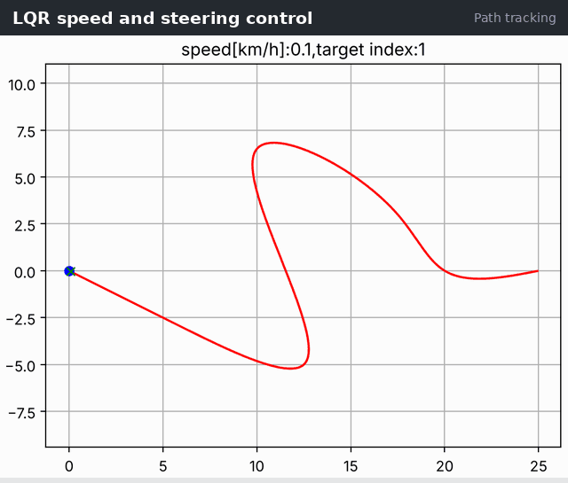

**How it works:** The sideways error, heading error and speed error go into one linear model, and an LQR controller computes the steering angle and acceleration that keep all three small for the least control effort. Red line: the course. Blue dots: the car's path. Green cross: the target point.

Path tracking simulation with LQR speed and steering control.

Reference

- [Towards fully autonomous driving: Systems and algorithms \- IEEE Conference Publication](https://ieeexplore.ieee.org/document/5940562/)


## Model predictive speed and steering control

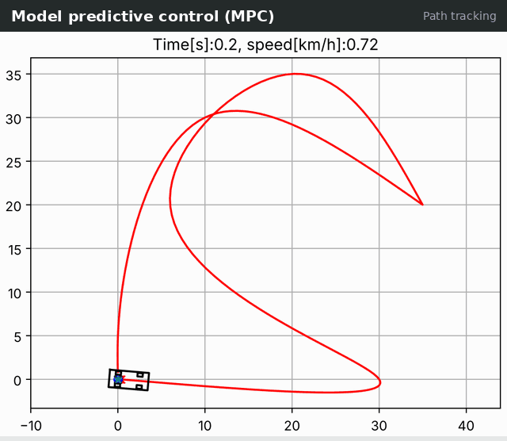

**How it works:** Every step the controller predicts the car's motion a few steps ahead with a linearised model and solves an optimisation (cvxpy) for the steering and acceleration that follow the course best within the car's limits; it applies the first command and repeats. Red line: the course. Blue dots: the car's path. Black: the car.

Path tracking simulation with iterative linear model predictive speed and steering control.

Reference

- [documentation](docs/modules/6_path_tracking/model_predictive_speed_and_steering_control/model_predictive_speed_and_steering_control_main.rst)

- Real\-time Model Predictive Control \(MPC\), ACADO, Python \| Work\-is\-Playing

## Nonlinear Model predictive control with C-GMRES

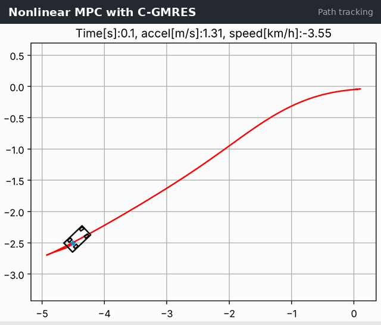

**How it works:** Nonlinear MPC solves an optimal control problem at every step. C-GMRES makes this fast: instead of solving from scratch, it follows how the solution changes over time with one cheap linear solve (GMRES) per step. The two-wheeled robot drives from its start to the target pose at the origin along the red path.

A motion planning and path tracking simulation with NMPC of C-GMRES 

Reference

- [documentation](docs/modules/6_path_tracking/cgmres_nmpc/cgmres_nmpc_main.rst)

## Model predictive path integral (MPPI) control

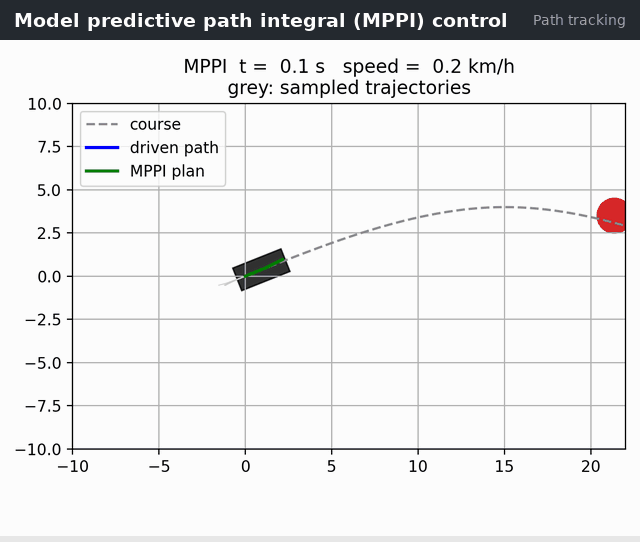

**How it works:** Every 0.1 s MPPI tries 300 random variations of its planned acceleration and steering sequence, simulates the car 2.5 s ahead with each one, and scores the trajectories: stay near the course, keep the target speed along the course (raw speed would reward circling at full speed), keep clear of the obstacles. The plan moves toward the cheap samples, each weighted by exp(-cost / λ); its first command is applied and the plan shifts one step. It needs no derivatives, so a cost can be as blunt as "hitting an obstacle costs 10,000". The steering angle is part of the car's state and MPPI samples how fast it changes, so the wheel turns smoothly. Grey: sampled trajectories. Green: the plan. Blue: the path driven. Red circles: obstacles.

- [sample code](PathTracking/mppi_control/mppi_control.py)

Reference

- Model Predictive Path Integral Control: From Theory to Parallel Computation

- Information Theoretic MPC for Model-Based Reinforcement Learning

## iLQR trajectory optimization

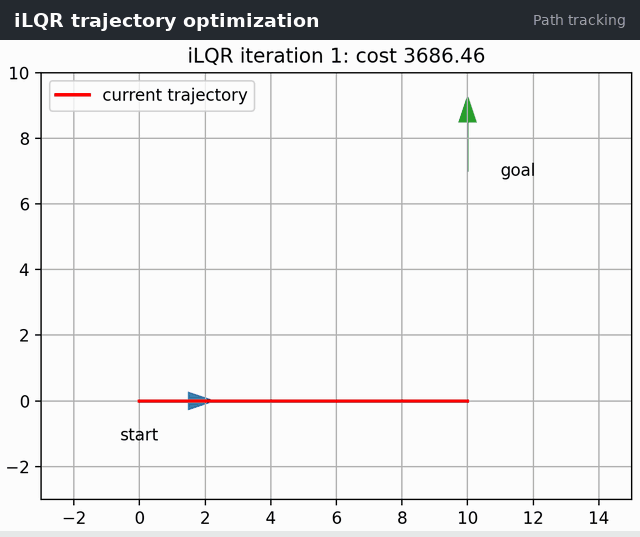

**How it works:** The car starts at rest and must stop at the goal pose, 10 m ahead and 7 m to the left, facing left, using as little acceleration and steering as possible. Starting from a car that does nothing, each iteration linearises the car model around the current trajectory, solves that simpler problem backwards in time (which gives every step a correction and a feedback gain), and rolls the corrected controls through the real model, halving the step until the cost drops. Grey: earlier iterations. Red: the current trajectory. Then the car drives the result.

- [sample code](PathTracking/ilqr/ilqr.py)

Reference

- Iterative Linear Quadratic Regulator Design for Nonlinear Biological Movement Systems

- Synthesis and Stabilization of Complex Behaviors through Online Trajectory Optimization

## Control barrier function safety filter

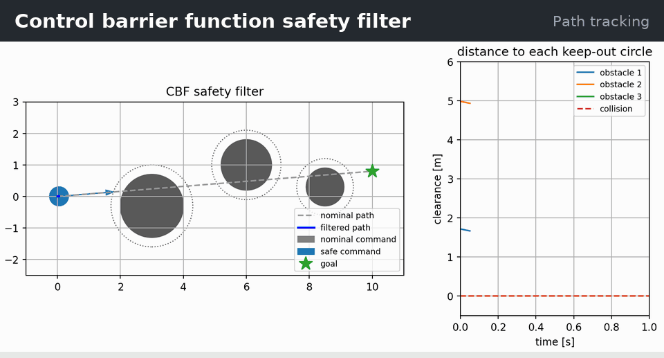

**How it works:** The robot's own controller heads straight for the goal (grey dashed line) and would drive into the first obstacle. A safety filter changes each command as little as possible so that every obstacle's barrier, the squared distance to the obstacle minus its squared radius, may shrink only in proportion to its size: it slows down as it nears zero and never crosses it. That is a tiny quadratic program, solved exactly every step, and a command that is already safe passes unchanged. Grey arrow: the nominal command. Blue arrow: the safe command. Right: the clearance to each obstacle reaches zero but never goes below it.

- [sample code](PathTracking/control_barrier_function/control_barrier_function.py)

Reference

- Control Barrier Functions: Theory and Applications


# Arm Navigation

How it works: turn a target point for the gripper into joint angles.


## N joint arm to point control


**How it works:** Inverse kinematics finds joint angles that put the end of the arm on the goal (green cross) by repeatedly stepping the angles with the inverse of the arm's Jacobian; each joint then turns toward its new angle under proportional control. The GIF picks random goals instead of mouse clicks.

N joint arm to a point control simulation.

This is an interactive simulation.

You can set the goal position of the end effector with left-click on the plotting area. 

In this simulation N = 10, however, you can change it.

## Arm navigation with obstacle avoidance 


**How it works:** Every pair of joint angles of the two-link arm is checked for collisions and stored in a grid (the configuration space; black: the arm would hit an obstacle). A* searches that grid, where the angles wrap around, for a collision-free route (orange), and then the arm follows it around the obstacles.

Arm navigation with obstacle avoidance simulation.

# Aerial Navigation

How it works: plan a trajectory, then fly it (drone) or optimise it (rocket).


## drone 3d trajectory following 


**How it works:** A quintic polynomial trajectory joins each pair of waypoints. Along it, a controller sets the thrust from the height error and the body torques from the attitude errors needed for the desired accelerations. Blue dotted line: the path flown.

This is a 3d trajectory following simulation for a quadrotor.

## rocket powered landing


**How it works:** The landing is an optimisation problem with nonlinear dynamics. Successive convexification linearises the dynamics around the current trajectory, solves the resulting convex problem with cvxpy, and repeats until the trajectory stops changing. The animation shows the rocket (black) and its thrust (red) on the way down.

This is a 3d trajectory generation simulation for a rocket powered landing.

Reference

- [documentation](docs/modules/8_aerial_navigation/rocket_powered_landing/rocket_powered_landing_main.rst)

# Bipedal

How it works: the walking body is modelled as an inverted pendulum.


## bipedal planner with inverted pendulum


**How it works:** The body is modelled as a linear inverted pendulum: a point mass kept at a constant height on a weightless leg, whose motion during one step has an exact formula. For each step the planner predicts the body's motion and moves the next footstep so the body ends the step where the plan wants it. Red: the body's path. Green: the support leg. Blue: the footsteps.

This is a bipedal planner for modifying footsteps for an inverted pendulum.

You can set the footsteps, and the planner will modify those automatically.

# License 

MIT

# Use-case

If this project helps your robotics project, please let me know with creating an issue.

Your robot's video, which is using Python Robotics Projects, is very welcome!!

# Contribution

Any contribution is welcome!! 

Please check this document:[How To Contribute — Python Robotics Projects documentation](docs/modules/0_getting_started/3_how_to_contribute_main.rst)

# <a id="support"></a>Supporting this project

If you would like to support this project, please contact us by creating an issue.

# Owner and maintainer

Python Robotics Projects is owned and maintained by Mahim Trivedi.
