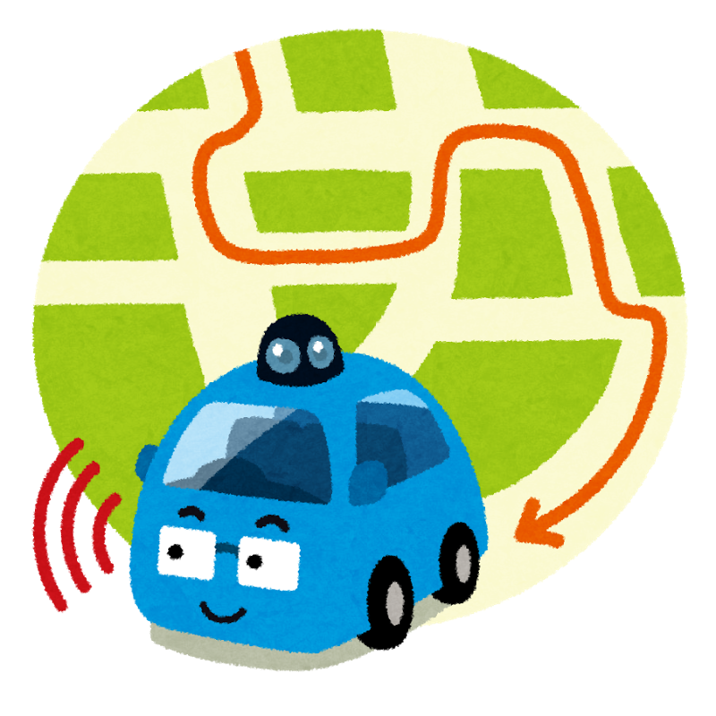

# MotionRobocar

Python codes and [textbook](docs/index_main.rst) for robotics algorithm.

Owned and maintained by **Mahim Trivedi**.


# Table of Contents
   * [What is this?](#what-is-motionrobocar)
   * [Requirements](#requirements-to-run-the-code)
   * [Documentation](#documentation-textbook)
   * [How to use](#how-to-use)
   * [Localization](#localization)
      * [Extended Kalman Filter localization](#extended-kalman-filter-localization)
      * [GPS/IMU Fusion Localization with Bias Estimation](#gpsimu-fusion-localization-with-bias-estimation)
      * [Particle filter localization](#particle-filter-localization)
      * [Histogram filter localization](#histogram-filter-localization)
   * [Mapping](#mapping)
      * [Gaussian grid map](#gaussian-grid-map)
      * [Ray casting grid map](#ray-casting-grid-map)
      * [Lidar to grid map](#lidar-to-grid-map)
      * [k-means object clustering](#k-means-object-clustering)
      * [Rectangle fitting](#rectangle-fitting)
   * [SLAM](#slam)
      * [Iterative Closest Point (ICP) Matching](#iterative-closest-point-icp-matching)
      * [FastSLAM 1.0](#fastslam-10)
   * [Path Planning](#path-planning)
      * [Dynamic Window Approach](#dynamic-window-approach)
      * [Grid based search](#grid-based-search)
         * [Dijkstra algorithm](#dijkstra-algorithm)
         * [A* algorithm](#a-algorithm)
         * [D* algorithm](#d-algorithm)
         * [D* Lite algorithm](#d-lite-algorithm)
         * [Potential Field algorithm](#potential-field-algorithm)
         * [Grid based coverage path planning](#grid-based-coverage-path-planning)
         * [Particle Swarm Optimization (PSO)](#particle-swarm-optimization-pso)  
      * [State Lattice Planning](#state-lattice-planning)
         * [Biased polar sampling](#biased-polar-sampling)
         * [Lane sampling](#lane-sampling)
      * [Probabilistic Road-Map (PRM) planning](#probabilistic-road-map-prm-planning)
      * [Rapidly-Exploring Random Trees (RRT)](#rapidly-exploring-random-trees-rrt)
         * [RRT*](#rrt)
         * [RRT* with reeds-shepp path](#rrt-with-reeds-shepp-path)
         * [LQR-RRT*](#lqr-rrt)
      * [Quintic polynomials planning](#quintic-polynomials-planning)
      * [Reeds Shepp planning](#reeds-shepp-planning)
      * [LQR based path planning](#lqr-based-path-planning)
      * [Optimal Trajectory in a Frenet Frame](#optimal-trajectory-in-a-frenet-frame)
   * [Path Tracking](#path-tracking)
      * [move to a pose control](#move-to-a-pose-control)
      * [Stanley control](#stanley-control)
      * [Rear wheel feedback control](#rear-wheel-feedback-control)
      * [Linear–quadratic regulator (LQR) speed and steering control](#linearquadratic-regulator-lqr-speed-and-steering-control)
      * [Model predictive speed and steering control](#model-predictive-speed-and-steering-control)
      * [Nonlinear Model predictive control with C-GMRES](#nonlinear-model-predictive-control-with-c-gmres)
   * [Arm Navigation](#arm-navigation)
      * [N joint arm to point control](#n-joint-arm-to-point-control)
      * [Arm navigation with obstacle avoidance](#arm-navigation-with-obstacle-avoidance)
   * [Aerial Navigation](#aerial-navigation)
      * [drone 3d trajectory following](#drone-3d-trajectory-following)
      * [rocket powered landing](#rocket-powered-landing)
   * [Bipedal](#bipedal)
      * [bipedal planner with inverted pendulum](#bipedal-planner-with-inverted-pendulum)
   * [License](#license)
   * [Use-case](#use-case)
   * [Contribution](#contribution)
   * [Support](#support)
   * [Owner and maintainer](#owner-and-maintainer)

# What is MotionRobocar?

MotionRobocar is a Python code collection and a [textbook](docs/index_main.rst) of robotics algorithms.

Features:

1. Easy to read for understanding each algorithm's basic idea.

2. Widely used and practical algorithms are selected.

3. Minimum dependency.

See this documentation for more details:

- [Getting Started — MotionRobocar documentation](docs/modules/0_getting_started/1_what_is_python_robotics_main.rst)


# Requirements to run the code

For running each sample code:

- [Python 3.13.x](https://www.python.org/)
 
- [NumPy](https://numpy.org/)
 
- [SciPy](https://scipy.org/)
 
- [Matplotlib](https://matplotlib.org/)
 
- [cvxpy](https://www.cvxpy.org/) 

For development:
  
- [pytest](https://pytest.org/) (for unit tests)
  
- [pytest-xdist](https://pypi.org/project/pytest-xdist/) (for parallel unit tests)
  
- [mypy](https://mypy-lang.org/) (for type check)
  
- [sphinx](https://www.sphinx-doc.org/) (for document generation)
  
- [pycodestyle](https://pypi.org/project/pycodestyle/) (for code style check)

# Documentation (Textbook)

This README only shows some examples of this project. 

If you are interested in other examples or mathematical backgrounds of each algorithm, 

You can check the full documentation (textbook) in the docs folder: [Welcome to MotionRobocar’s documentation\! — MotionRobocar documentation](docs/index_main.rst)

# How to use

1. Clone or download this repo.


2. Install the required libraries.

- using conda :

  ```terminal
  conda env create -f requirements/environment.yml
  ```
 
- using pip :

  ```terminal
  pip install -r requirements/requirements.txt
  ```


3. Execute python script in each directory.

4. Add star to this repo if you like it :smiley:. 

# Localization

## Extended Kalman Filter localization

Reference

- [documentation](docs/modules/2_localization/extended_kalman_filter_localization_files/extended_kalman_filter_localization_main.rst)

## GPS/IMU Fusion Localization with Bias Estimation

An extended Kalman filter fuses body-frame accelerometer and gyroscope readings
with lower-rate GPS positions, estimates sensor biases, and continues inertial
prediction during a temporary GPS outage. The animation compares it with an
EKF without bias estimation and IMU-only dead reckoning using the same sensor
measurements. It also plots the accelerometer and gyroscope bias estimates
against their true values, with covariance-derived 3σ position ellipses and
bias uncertainty bands.

- [documentation](docs/modules/2_localization/gps_imu_fusion/gps_imu_fusion_main.rst)
- [sample code](Localization/gps_imu_fusion/gps_imu_fusion.py)

## Particle filter localization

This is a sensor fusion localization with Particle Filter(PF).

The blue line is true trajectory, the black line is dead reckoning trajectory,

and the red line is an estimated trajectory with PF.

It is assumed that the robot can measure a distance from landmarks (RFID).

These measurements are used for PF localization.

Reference

- [PROBABILISTIC ROBOTICS](http://www.probabilistic-robotics.org/)


## Histogram filter localization

This is a 2D localization example with Histogram filter.

The red cross is true position, black points are RFID positions.

The blue grid shows a position probability of histogram filter.  

In this simulation, x,y are unknown, yaw is known.

The filter integrates speed input and range observations from RFID for localization.

Initial position is not needed.

Reference

- [PROBABILISTIC ROBOTICS](http://www.probabilistic-robotics.org/)

# Mapping

## Gaussian grid map

This is a 2D Gaussian grid mapping example.

## Ray casting grid map

This is a 2D ray casting grid mapping example.

## Lidar to grid map

This example shows how to convert a 2D range measurement to a grid map.

## k-means object clustering

This is a 2D object clustering with k-means algorithm.

## Rectangle fitting

This is a 2D rectangle fitting for vehicle detection.

# SLAM

Simultaneous Localization and Mapping(SLAM) examples

## Iterative Closest Point (ICP) Matching

This is a 2D ICP matching example with singular value decomposition.

It can calculate a rotation matrix, and a translation vector between points and points.

Reference

- Introduction to Mobile Robotics: Iterative Closest Point Algorithm


## FastSLAM 1.0

This is a feature based SLAM example using FastSLAM 1.0.

The blue line is ground truth, the black line is dead reckoning, the red line is the estimated trajectory with FastSLAM.

The red points are particles of FastSLAM.

Black points are landmarks, blue crosses are estimated landmark positions by FastSLAM.


Reference

- [PROBABILISTIC ROBOTICS](http://www.probabilistic-robotics.org/)

- SLAM simulations


# Path Planning

## Dynamic Window Approach

This is a 2D navigation sample code with Dynamic Window Approach.

- The Dynamic Window Approach to Collision Avoidance

## Grid based search

### Dijkstra algorithm

This is a 2D grid based the shortest path planning with Dijkstra's algorithm.

In the animation, cyan points are searched nodes.

### A\* algorithm

This is a 2D grid based the shortest path planning with A star algorithm.

In the animation, cyan points are searched nodes.

Its heuristic is 2D Euclid distance.

### D\* algorithm

This is a 2D grid based the shortest path planning with D star algorithm.

The animation shows a robot finding its path avoiding an obstacle using the D* search algorithm.

Reference

- [D* Algorithm Wikipedia](https://en.wikipedia.org/wiki/D*)

### D\* Lite algorithm

This algorithm finds the shortest path between two points while rerouting when obstacles are discovered. It has been implemented here for a 2D grid.

The animation shows a robot finding its path and rerouting to avoid obstacles as they are discovered using the D* Lite search algorithm.

Refs:

- [D* Lite](http://idm-lab.org/bib/abstracts/papers/aaai02b.pdf)
- Improved Fast Replanning for Robot Navigation in Unknown Terrain

### Potential Field algorithm

This is a 2D grid based path planning with Potential Field algorithm.

In the animation, the blue heat map shows potential value on each grid.

Reference

- Robotic Motion Planning:Potential Functions

### Grid based coverage path planning

This is a 2D grid based coverage path planning simulation.

### Particle Swarm Optimization (PSO)

This is a 2D path planning simulation using the Particle Swarm Optimization algorithm.

PSO is a metaheuristic optimization algorithm inspired by bird flocking behavior. In path planning, particles explore the search space to find collision-free paths while avoiding obstacles.

The animation shows particles (blue dots) converging towards the optimal path (yellow line) from start (green area) to goal (red star).

References

- [Particle swarm optimization - Wikipedia](https://en.wikipedia.org/wiki/Particle_swarm_optimization)

- ["Particle Swarm Optimization" (1995)](https://ieeexplore.ieee.org/document/488968)


## State Lattice Planning

This script is a path planning code with state lattice planning.

This code uses the model predictive trajectory generator to solve boundary problem.

Reference 

- [Optimal rough terrain trajectory generation for wheeled mobile robots](https://journals.sagepub.com/doi/pdf/10.1177/0278364906075328)

- State Space Sampling of Feasible Motions for High-Performance Mobile Robot Navigation in Complex Environments


### Biased polar sampling

Target states are sampled on a polar grid, more densely around the goal direction.

### Lane sampling

Target states are sampled across the width of a lane ahead of the vehicle.

## Probabilistic Road-Map (PRM) planning 

This PRM planner uses Dijkstra method for graph search.

In the animation, blue points are sampled points,

Cyan crosses means searched points with Dijkstra method,

The red line is the final path of PRM.

Reference

- [Probabilistic roadmap \- Wikipedia](https://en.wikipedia.org/wiki/Probabilistic_roadmap)

　　

## Rapidly-Exploring Random Trees (RRT)

### RRT\*

This is a path planning code with RRT\*

Black circles are obstacles, green line is a searched tree, red crosses are start and goal positions.

Reference

- [Incremental Sampling-based Algorithms for Optimal Motion Planning](https://arxiv.org/abs/1005.0416)

- [Sampling-based Algorithms for Optimal Motion Planning](https://citeseerx.ist.psu.edu/document?repid=rep1&type=pdf&doi=bddbc99f97173430aa49a0ada53ab5bade5902fa)

### RRT\* with reeds-shepp path

Path planning for a car robot with RRT\* and reeds shepp path planner.

### LQR-RRT\*

This is a path planning simulation with LQR-RRT\*.

A double integrator motion model is used for LQR local planner.

Reference

- LQR\-RRT\*: Optimal Sampling\-Based Motion Planning with Automatically Derived Extension Heuristics

- LQR\-RRTstar: LQR\-RRT\* method is used for random motion planning of a simple pendulum in its phase plot


## Quintic polynomials planning

Motion planning with quintic polynomials.

It can calculate a 2D path, velocity, and acceleration profile based on quintic polynomials.

Reference

- [Local Path Planning And Motion Control For Agv In Positioning](https://ieeexplore.ieee.org/document/637936/)

## Reeds Shepp planning

A sample code with Reeds Shepp path planning.

Reference

- 15.3.2 Reeds\-Shepp Curves

- [optimal paths for a car that goes both forwards and backwards](https://pdfs.semanticscholar.org/932e/c495b1d0018fd59dee12a0bf74434fac7af4.pdf)

- pyReedsShepp: Implementation of Reeds Shepp curve\.


## LQR based path planning

A sample code using LQR based path planning for double integrator model.

## Optimal Trajectory in a Frenet Frame 

This is optimal trajectory generation in a Frenet Frame.

The cyan line is the target course and black crosses are obstacles.

The red line is the predicted path.

Reference

- Optimal Trajectory Generation for Dynamic Street Scenarios in a Frenet Frame

- [Optimal trajectory generation for dynamic street scenarios in a Frenet Frame](https://www.youtube.com/watch?v=Cj6tAQe7UCY)


# Path Tracking

## move to a pose control

This is a simulation of moving to a pose control

Reference

- ["Robotics, Vision and Control" \| SpringerLink p102](https://link.springer.com/book/10.1007/978-3-642-20144-8)


## Stanley control

Path tracking simulation with Stanley steering control and PID speed control.

Reference

- Stanley: The robot that won the DARPA grand challenge

- [Automatic Steering Methods for Autonomous Automobile Path Tracking](https://www.ri.cmu.edu/pub_files/2009/2/Automatic_Steering_Methods_for_Autonomous_Automobile_Path_Tracking.pdf)


## Rear wheel feedback control

Path tracking simulation with rear wheel feedback steering control and PID speed control.

Reference

- [A Survey of Motion Planning and Control Techniques for Self-driving Urban Vehicles](https://arxiv.org/abs/1604.07446)


## Linear–quadratic regulator (LQR) speed and steering control

Path tracking simulation with LQR speed and steering control.

Reference

- [Towards fully autonomous driving: Systems and algorithms \- IEEE Conference Publication](https://ieeexplore.ieee.org/document/5940562/)


## Model predictive speed and steering control

Path tracking simulation with iterative linear model predictive speed and steering control.

Reference

- [documentation](docs/modules/6_path_tracking/model_predictive_speed_and_steering_control/model_predictive_speed_and_steering_control_main.rst)

- Real\-time Model Predictive Control \(MPC\), ACADO, Python \| Work\-is\-Playing

## Nonlinear Model predictive control with C-GMRES

A motion planning and path tracking simulation with NMPC of C-GMRES 

Reference

- [documentation](docs/modules/6_path_tracking/cgmres_nmpc/cgmres_nmpc_main.rst)


# Arm Navigation

## N joint arm to point control

N joint arm to a point control simulation.

This is an interactive simulation.

You can set the goal position of the end effector with left-click on the plotting area. 

In this simulation N = 10, however, you can change it.

## Arm navigation with obstacle avoidance 

Arm navigation with obstacle avoidance simulation.

# Aerial Navigation

## drone 3d trajectory following 

This is a 3d trajectory following simulation for a quadrotor.

## rocket powered landing

This is a 3d trajectory generation simulation for a rocket powered landing.

Reference

- [documentation](docs/modules/8_aerial_navigation/rocket_powered_landing/rocket_powered_landing_main.rst)

# Bipedal

## bipedal planner with inverted pendulum

This is a bipedal planner for modifying footsteps for an inverted pendulum.

You can set the footsteps, and the planner will modify those automatically.

# License 

MIT

# Use-case

If this project helps your robotics project, please let me know with creating an issue.

Your robot's video, which is using MotionRobocar, is very welcome!!

# Contribution

Any contribution is welcome!! 

Please check this document:[How To Contribute — MotionRobocar documentation](docs/modules/0_getting_started/3_how_to_contribute_main.rst)

# <a id="support"></a>Supporting this project

If you would like to support this project, please contact us by creating an issue.

# Owner and maintainer

MotionRobocar is owned and maintained by Mahim Trivedi.
